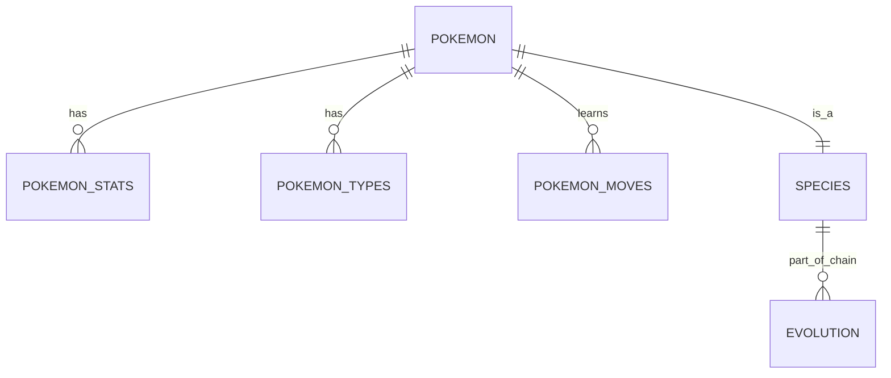

# 🔴⚪ PokéData Warehouse ETL


> **Pipeline de Dados Assíncrono** (ETL) que extrai, transforma e carrega o universo Pokémon inteiro da [PokéAPI](https://pokeapi.co/) para um Data Warehouse relacional local (SQLite), otimizado para alta performance e resiliência.

## 📋 Sobre o Projeto

Este projeto resolve o problema de latência e limites de requisição ao trabalhar com APIs públicas. Em vez de consultar a API em tempo real para cada análise, este script constrói um **Banco de Dados Relacional** completo na sua máquina.

A arquitetura utiliza **Python Async (asyncio + aiohttp)** para realizar requisições concorrentes em lotes, tornando a coleta de dados infinitamente mais rápida que loops tradicionais, enquanto mantém a integridade relacional entre Pokémons, espécies, evoluções e movimentos.

---

## 🚀 Funcionalidades de Engenharia de Dados

### 1. ⚡ Alta Performance (Concurrency)
- **Extração Assíncrona:** Utiliza `aiohttp` para buscar dados em paralelo (Lotes de 20 requests simultâneos).
- **Sem Bloqueios:** O script não "trava" esperando uma resposta da API para iniciar a próxima.

### 2. 🛡️ Resiliência e Robustez
- **Retry Logic:** Implementação inteligente de tentativas (`fetch_with_retry`). Se a API falhar ou der timeout, o script espera e tenta novamente até 3 vezes antes de desistir.
- **Transações Atômicas:** *Commits* no banco são feitos por lotes, garantindo que você não perca tudo se a internet cair no meio do processo.

### 3. 💾 Modelagem Relacional (Schema)
Os dados não são apenas jogados em JSONs. Eles são normalizados em tabelas SQL conectadas por chaves estrangeiras:
- **`pokemon`**: Dados base (peso, altura, xp).
- **`pokemon_stats`**: Atributos de batalha (HP, Attack, Speed...).
- **`pokemon_types`**: Tipagem (Fogo, Água, etc.).
- **`pokemon_moves`**: Movimentos e como são aprendidos.
- **`species`**: Dados biológicos, cor, habitat e se é lendário/mítico.
- **`evolution`**: Cadeia complexa de evolução mapeada (quem evolui para quem e como).

---

## 🛠️ Tecnologias Utilizadas

* **[Python 3.10+](https://www.python.org/):** Linguagem core.
* **[Aiohttp](https://docs.aiohttp.org/):** Cliente HTTP assíncrono para requests paralelos.
* **[Asyncio](https://docs.python.org/3/library/asyncio.html):** Gerenciamento de loop de eventos e concorrência.
* **[SQLite3](https://www.sqlite.org/):** Banco de dados serverless e leve, embutido no Python.
* **[Requests](https://pypi.org/project/requests/):** Usado pontualmente para requests síncronos de inicialização.

---

## 📦 Como Rodar o Projeto

Siga os passos para popular seu banco de dados:

1.  **Clone o repositório:**
    ```bash
    git clone https://github.com/FarandaMauricio-make/pokemon-etl-pipeline.git
    cd pokemon-etl-pipeline
    ```

2.  **Crie um ambiente virtual (Recomendado):**
    ```bash
    python -m venv venv
    # Windows:
    venv\Scripts\activate
    # Linux/Mac:
    source venv/bin/activate
    ```

3.  **Instale as dependências:**
    As dependências (`aiohttp` e `requests`) estão no `requirements.txt`.
    ```bash
    pip install -r requirements.txt
    ```

4.  **Execute o ETL:**
    ```bash
    python Pokemon_pc.py
    ```
    *Aguarde a barra de progresso no terminal. O processo pode levar alguns minutos dependendo da sua conexão, pois baixará dados de mais de 1000 Pokémons.*

5.  **Verifique os Dados:**
    Um arquivo `pokemon_dw.db` será criado na raiz. Você pode abri-lo com qualquer visualizador SQL (como *DB Browser for SQLite* ou *DBeaver*).

---

## 🔍 Estrutura do Banco de Dados

O script gera automaticamente o seguinte esquema relacional:



## ⚠️ Nota sobre a API

Este projeto consome a **PokéAPI v2**.

* **Respeite os limites:** A API é pública. O script já possui `delay` e `batch_size` configurados para não sobrecarregar o servidor deles (*Good Citizen Policy*).

---

## 🤝 Contribuição

Quer melhorar a modelagem ou adicionar dados de sprites?

1.  Faça um **Fork**.
2.  Crie sua Feature Branch (`git checkout -b feature/AddSprites`).
3.  **Commit** suas mudanças.
4.  **Push** para a Branch.
5.  Abra um **Pull Request**.

---

**Gotta Catch 'Em All! (In SQL)** 🧢
